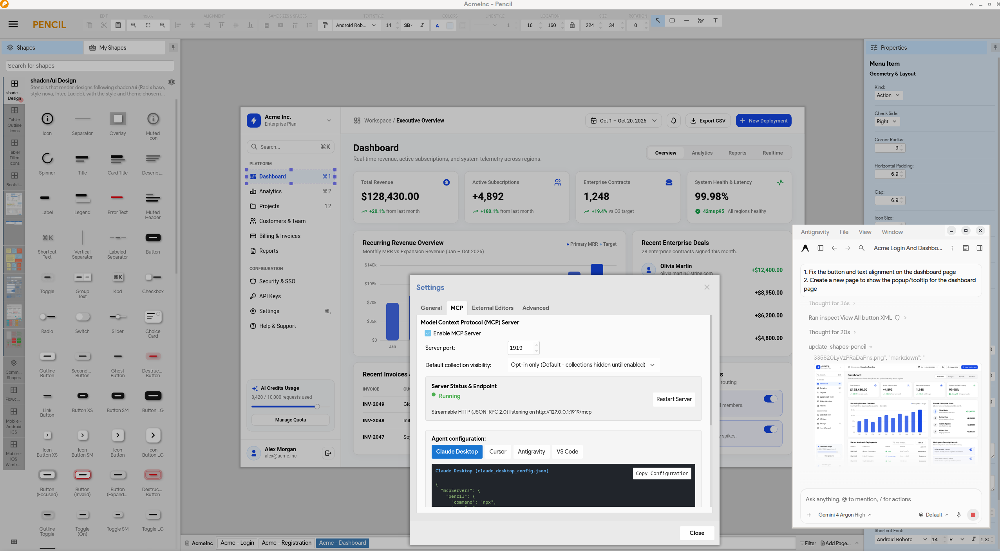

About Pencil V4
===============

Pencil V4 adds native support for the Model Context Protocol (MCP), allowing AI assistants, such as Claude Desktop, Cursor, Antigravity, or VS Code to interact directly with your Pencil canvas.

Wireframing often involves repetitive work: dragging shapes, nudging pixels, searching for icons, and manually adjusting layouts whenever requirements change. With Pencil V4, you can describe what you need in plain text. Your connected assistant can create shapes, set up layouts, and make edits directly in your open document.

Whether you are a designer sketching early concepts, a product manager mapping user flows, or an engineer prototyping a new feature, Pencil lets you build and iterate on wireframes through conversation instead of manual drawing.


Key Capabilities
================

With MCP enabled, your assistant can read and modify the canvas directly:

  * **Translate Prompts into Editable Pencil Designs**: Turn natural language descriptions into native, fully editable Pencil shapes and stencils rather than static images, so you can continue tweaking them by hand on canvas at any time.
  * **Create Screens from Text**: Describe a component or page, such as a login dialog, a pricing comparison, or a dashboard. The assistant selects matching stencils, sets up the layout, and places elements on the canvas.
  * **Visual Feedback Loop**: Pencil returns snapshot previews after edits, allowing the assistant to inspect spacing, alignment, and text contrast, and adjust properties if needed.
  * **Automatic Layouts & Spacing**: Containers automatically handle element stacking, padding, and alignment, keeping wireframes consistent without manual pixel calculations.
  * **Iterative Editing**: Ask for changes naturally, update colors, apply rounded corners, shift sections to insert new content, or reorder elements without starting over.
  * **Built-in Icon & Stencil Search**: The assistant can search installed icon libraries (such as Tabler, Lucide, and FontAwesome) and place vector icons directly into your design.
  * **Live On-Screen Indicators**: A status indicator and canvas highlights show which elements the assistant is selecting or updating while it works.
  * **Built-in Local Server**: No external tools or background daemons to set up. Pencil runs its own MCP server on `localhost:1919`, ready to connect from your preferred client.


Example Prompts
===============

Here are common prompt examples when working with Pencil and an AI assistant:

* **Create new screens**:
  * *"Use Pencil MCP and the shadcn/ui stencil collection to design the Acme login form, registration form, and a dashboard page. Leverage icons from the Tabler outline/filled icon collection resources."*
  * *"Create a clean login modal with email, password, a 'Remember Me' checkbox, and a primary Sign In button."*
  * *"Design a pricing page with three plans (Starter, Pro, Enterprise) and highlight the Pro plan."*
  * *"Build a mobile dashboard screen with a balance card at the top and a list of recent transactions below."*

* **Tweak and style components**:
  * *"Make all primary buttons dark blue with rounded corners and white text."*
  * *"Increase the spacing between form inputs to 16px and align all labels to the left."*
  * *"Change the card grid on this page into a single-column list."*

* **Add icons and graphics**:
  * *"Find a shopping cart icon from Tabler icons and place it on the top-right header."*
  * *"Replace the placeholder circles next to the usernames with user avatar icons."*

* **Rearrange layouts and pages**:
  * *"Shift the footer down by 80px and add an email newsletter signup box above it."*
  * *"Create a new page called 'Settings' with account and notification tabs."*
  * *"Check the current screen and fix any elements that look misaligned or hard to read."*


Connecting AI Clients
=====================

Pencil runs its MCP server on port `1919` by default. You can enable or disable the server, or change the port, under **Settings > MCP**.

To connect your assistant, add Pencil to its configuration:

### Claude Desktop

Add to `claude_desktop_config.json`:

```json
{
  "mcpServers": {
    "pencil": {
      "command": "npx",
      "args": [
        "-y",
        "mcp-remote",
        "http://127.0.0.1:1919/mcp"
      ]
    }
  }
}
```

### Cursor

Add to `.cursor/mcp.json`:

```json
{
  "mcpServers": {
    "pencil": {
      "url": "http://127.0.0.1:1919/mcp"
    }
  }
}
```

### Antigravity

Add to `mcp_config.json`:

```json
{
  "mcpServers": {
    "pencil": {
      "serverUrl": "http://127.0.0.1:1919/mcp"
    }
  }
}
```

### VS Code

Add to `.vscode/mcp.json`:

```json
{
  "servers": {
    "pencil": {
      "type": "http",
      "url": "http://127.0.0.1:1919/mcp"
    }
  }
}
```


Setting up
==========

Pencil uses [Electron](https://www.electronjs.org/) as the runtime, follow these steps to setup the environment:

  * Clone this repository
  * Make sure you are using *nodejs 14+* and *npm* (or *yarn*)
  * Checkout this branch:
  
    ```bash
    $ git checkout pencil-mcp-integration
    ```
    
  * Install dependencies:

    ```bash
    $ npm install
    ```
      
  * Start Pencil using the prebuilt version of Electron:

    ```bash
    $ npm start
    ```


Supported Platforms
==================

OS X
----

Only OSX 64bit 10.9 and later are supported. Apple Silicon (arm64) builds are supported.

Windows
------

Windows 7 and later are supported, older operating systems are not supported (and do not work).

Linux
-----

* Tested
    * Ubuntu 12.04 and later
    * Fedora 21+
    * Debian 8+
* Packages
    * **Arch Linux** - [pencil](https://aur.archlinux.org/packages/pencil/) on the [Arch User Repository](https://aur.archlinux.org/).
    * **Gentoo Linux** - [media-gfx/evoluspencil](https://packages.gentoo.org/packages/media-gfx/evoluspencil).


